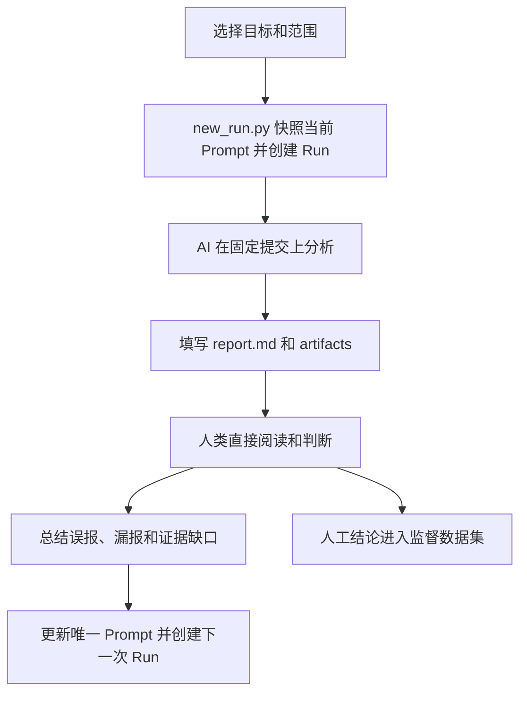

# 当前分析工作流

本文描述仓库当前实际执行的 AI 辅助缺陷分析流程。AI 负责按固定格式写报告，人类直接阅读证据并给出最终判断。

## 总览



工作流只有两个核心产物：

- `manifest.json`：记录本轮实验配置和精确的上游提交。
- `report.md`：AI 的格式化分析和人类的最终评价写在同一份 Markdown 中。

不再需要额外的 Python 校验、JSON review 或自动评分步骤。

## 1. 准备上游版本

默认使用父仓库为 `upstream/warpo` 和 `upstream/wasm-compiler` 配置的 submodule commit，
不追踪远端最新分支。初始化或同步版本只需：

```bash
./scripts/update_upstreams.sh
```

## 2. 创建一次 Run

先确定单一、可审计的分析范围：

```bash
python3 scripts/new_run.py \
  --run-id run-002-warpo-parser \
  --agent <agent-or-harness> \
  --target warpo \
  --scope "frontend parser diagnostics" \
  --temperature 0 \
  --budget "60 minutes"
```

脚本生成：

```text
runs/run-002-warpo-parser/
  manifest.json
  prompt.md
  report.md
  artifacts/
```

- `manifest.json` 记录执行参数、范围、Prompt 哈希、harness 提交和上游 commit。
- `prompt.md` 是唯一源 Prompt `prompts/defect-discovery.md` 在本轮创建时的快照。
- `report.md` 是 AI 输出和人工评价的共同载体，元数据中列出提交号，AI 按 Prompt 补充检查到的 tag。
- `artifacts/` 保存最小复现输入和精简日志。

仓库只维护 `prompts/defect-discovery.md` 这一个源 Prompt。Run 生成器总是快照它的当前内容，并在 manifest 中记录 SHA-256。旧 Run 使用各自目录中的 `prompt.md` 保留当时内容，因此后续迭代源 Prompt 不会改变历史实验。

创建 Run 时检查所选目标已初始化、工作树干净、`HEAD` 与配置 commit 一致，失败即报错退出。

Run ID 不复用。修改 Prompt、执行配置、范围或重试实验时都创建新 Run。旧 Run 的 manifest、Prompt 和已审阅报告不做迁移。

## 3. AI 分析

让分析 agent 读取本轮的 `manifest.json` 和 `prompt.md`，只分析声明的目标与范围。发现阶段不修改两个上游 submodule。

AI 按本轮 Prompt 的搜索循环工作并填写 `report.md`。候选输入边界、准入条件、artifact 要求、结论和价值评级统一以 [verdict policy](../knowledge-base/verdict-policy.md) 为准。

探索时允许先做低成本的小型源码探针，借此确认可达性和实际行为；证明尚未完成不是禁止实验的理由。但探针不能直接升格成候选。只有通过 policy 的报告准入门槛后才进入 Candidate Findings；未复现或被否定的线索保留在分析日志中，而不是用 `defer` 绕过门槛。

### 3.1 Warpo 固定构建与执行入口

读取 [Warpo workflow skill](../.github/skills/warpo-defect-workflow/SKILL.md)，按其中步骤核对基线、安装依赖、构建、编译探针和执行模块。该 skill 是操作步骤的唯一维护位置，包含 smoke 检查、导出函数与 start-only 两种执行方式，以及原生编译器崩溃时的取证方法。

### 3.2 中文分析过程记录

日志的内容、追加时机和最终报告格式由本轮 `prompt.md` 定义，见[源 Prompt 的 Output 部分](../prompts/defect-discovery.md#output)。旧 Run 仍按自己的快照执行，不要用后来更新的源 Prompt 重写其日志或人工评价。

## 4. 人类阅读和评价

打开：

```text
runs/run-002-warpo-parser/report.md
```

直接填写报告中的“人工评价”部分，即本仓库的监督信号：

- 最终结论：`accept` / `downgrade` / `reject` / `defer`；
- 价值：`high` / `low` / `none` / `unknown`；
- `Review`：评价和依据。

## 5. 迭代 Prompt

根据报告中的人工评价总结：

- AI 把设计预期误判成 bug 的地方；
- AI 没有检查生产者可达性的地方；
- 复现或 oracle 不充分的地方；
- 重复发现和搜索遗漏。

同时检查报告是否把已否定的假设当作候选输出、是否把多个 bug 合并进同一个复现文件，以及是否把低价值边界问题误标成高价值。

更新 `prompts/defect-discovery.md`，然后人工审核。

当前 Prompt 引用的 `supervision/` 轮次只能作为训练/回归监督。选择 Prompt revision 要使用未泄漏标签的 validation；最终泛化结果使用 holdout。

## 6. 写入监督数据集或修复

一轮人工审阅完成后，在 `supervision/<round-id>/` 中只保存 `review.md` 和 `oracle.json`。前者记录人类可读的判断和流程反馈，后者记录供 Prompt 迭代与评估使用的结构化标签。复现源码、编译产物和运行日志不复制进监督目录。

## 仓库工具职责

| 文件 | 职责 |
| --- | --- |
| `scripts/new_run.py` | 记录配置 commit，创建 Run 并快照 Prompt |
| `scripts/update_upstreams.sh` | 同步配置的 submodule commit |
