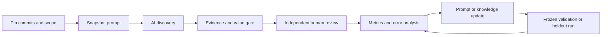

# Methodology

## Objective

The experiment optimizes for **verified, high-value defects per reviewed candidate**, not raw finding volume. Compiler review is especially prone to attractive false positives because internal IR accepts states that the public producer never creates, and because legal optimizations may intentionally differ from source-level intuition.

The current central hypothesis is:

> Requiring supported-input reachability, an executable semantic oracle, candidate-specific reproducers, explicit state-transition explanations, and a locally grounded value judgment will preserve real parser, miscompilation, and runtime-state findings while suppressing synthetic IR, intended-behavior reports, and low-value boundary distractions.

This is falsifiable. Keep scope and target commits fixed, run prompt revisions, review them blind to revision identity when practical, and compare precision, yield, unreachable false positives, and holdout recall.

## Pipeline

Discovery and judgment are visible in the same `report.md`: the AI fills the candidate sections and the human fills the marked judgment sections. This repository does not require a machine scoring layer; the human decision is the oracle.

Each discovery report also contains a public Chinese analysis log written as the work proceeds. It preserves the order of explored directions, hypotheses, checks, rejected leads, and pivots, including why each direction was selected. The final report leaves this contemporaneous log in place rather than reconstructing a polished audit after the run.

The Python helper does not invoke a model. It creates an experiment envelope only. Model execution is performed manually through VS Code Copilot Agent mode, which reads the run's prompt and manifest, investigates the pinned checkout with its normal tools, and writes the Markdown report.

## Evidence Policy

[Verdict policy](../knowledge-base/verdict-policy.md) is the authoritative source for
supported-input boundaries, evidence obligations, report admission, decisions, and value
ratings. This methodology describes experiment design, not a second set of triage rules.

Exploration and reporting are separate stages: a small source probe can resolve uncertain
reachability or behavior before a complete proof exists. Only after the policy's admission
gate is met does that lead become a reported candidate. An unexecuted code-inspection
hypothesis remains in the analysis log, not a `defer` finding.

Operational steps belong to the target skill; the discovery loop and report format belong
to the run's prompt snapshot. The human remains responsible for the final judgment.

## Iterating The Prompt Without Leakage

1. Freeze scope, target commits, model settings, budget, and a snapshot of the current prompt before a run.
2. Use stable IDs for reported candidates. Omit AI-rejected hypotheses and summarize unsuccessful search only at the area level.
3. Have a human review evidence rather than model rhetoric.
4. Diagnose errors by category: missed reachability check, misunderstood design, weak oracle, duplicate, or search miss.
5. Change one mechanism in `prompts/defect-discovery.md` at a time when possible.
6. Re-run known training cases only as a regression check.
7. Select prompt revisions on a frozen validation set, identifying each revision by its run snapshot and hash.
8. Open the holdout only after choosing the prompt. Do not paste holdout labels back into the prompt until that evaluation cycle is closed.

Use multiple seeds or repeated runs when model sampling is nondeterministic. Report the distribution, not only the best run. Keep token/time budgets equal when comparing strategies.

## Search Strategy

Partition searches by ownership boundary rather than scanning the whole repository in one conversation:

1. parser and diagnostic recovery;
2. source evaluation order and lowering;
3. optimization semantic preservation;
4. Wasm parsing, validation, and feature gates;
5. architecture-specific code generation;
6. compiler/runtime ABI, memory, and trap behavior;
7. repeated compile/instantiate/reset state;
8. Warpo-to-wasm-compiler differential pipeline.

For each bounded scope, require the agent to report areas checked with no finding. This makes search coverage auditable and helps identify blind spots.

## Open-Source Patterns Used

The repository borrows mechanisms, not domain content, from these projects:

- [SWE-bench](https://github.com/SWE-bench/SWE-bench): immutable task identities, pinned code, container-oriented reproducibility, per-run logs, and separate fail-to-pass/pass-to-pass tests. Applied here as pinned submodules, immutable run envelopes, focused failure oracles, and control tests.
- [Magma](https://hexhive.epfl.ch/magma/docs/technical.html): ground-truth canaries distinguish a bug location being **reached** from its fault condition being **triggered**. Applied here as an internal reachability gate followed by an observed oracle in the report.
- [Semgrep rule testing](https://semgrep.dev/docs/writing-rules/testing-rules): positive and negative fixtures make both detection and false-positive behavior explicit. Applied here through a nearby control for each reported candidate without surfacing rejected hypotheses as findings.
- [OSS-Fuzz ideal integration](https://google.github.io/oss-fuzz/advanced-topics/ideal-integration/): checked-in targets, coverage-oriented seed corpora, reproducible testcases, and promotion of found failures into regression tests. Applied here through local minimal artifacts and permanent human supervision labels.
- [OSS-Fuzz reproduction workflow](https://google.github.io/oss-fuzz/advanced-topics/reproducing/): reproduce on an exact build before fixing and rerun the testcase after repair. Applied here as mandatory baseline command evidence.
- [Inspect AI](https://inspect.aisi.org.uk/tasks.html): separate dataset, solver, and scorer; parameterized evals; stable sample IDs; complete run logs and re-scoring. Applied here as separate prompt, candidates, human review, and metrics files.
- [wasm-compiler differential fuzzer](../upstream/wasm-compiler/fuzz/reference/main.cpp): generates Wasm with `wasm-opt` and obtains reference behavior with `wasm-interp`. Reuse this existing oracle for compiler/runtime candidates instead of inventing a parallel interpreter.
- [wasm-compiler AFL++ harness](../upstream/wasm-compiler/fuzz/afl_harness/Readme.md): preserves crash inputs and provides a direct replay command. Feed minimized, deduplicated failures into AI analysis and regression cases.

The first implementation intentionally uses standard-library Python and JSON files. Adopt a larger framework such as Inspect only when model invocation, sandbox concurrency, or log volume makes the local harness insufficient.

## Supervision Promotion Rules

A human-confirmed finding should move from a run into the supervision set only after
the [verdict policy](../knowledge-base/verdict-policy.md) evidence and artifact requirements
are met. Assign a stable ID and split, remove sensitive or bulky content from supervision
records, and follow [supervision promotion guidance](../supervision/README.md).

Do not train on a validation or holdout label during the same evaluation cycle.